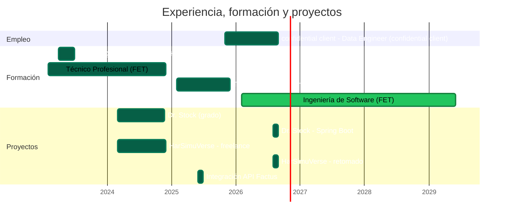

> **EN:** Data engineer and fullstack developer from Colombia. I build Python ETL pipelines orchestrated with Apache Airflow on AWS, and full applications with Java/Spring Boot and Angular. Open to remote roles.

## 👋 Sobre mí

Soy Juan, Data Engineer y desarrollador Fullstack. Me gusta trabajar donde los datos y el código se cruzan: llevar algo desde una idea hasta que corre en producción, y que siga corriendo cuando crece.

Del lado de datos he construido pipelines ETL, automatización y nube; del lado de aplicaciones, sistemas completos de punta a punta: un sistema de inventario y punto de venta, facturación electrónica y una plataforma educativa para niños. Java sigue siendo mi lenguaje preferido; en datos, mi día a día es Python y SQL.

Voy en el **8vo semestre de Ingeniería de Software** en la FET. Fuera del código practico karate desde hace 8 años 🥋: la misma disciplina de repetir hasta que algo funcione bien la aplico al aprender tecnología nueva.

---

## 🧰 Stack tecnológico

| Área | Tecnologías |
|---|---|
| **Datos & Cloud** |  |
| **Lenguajes** |  |
| **Backend** |  |
| **Frontend** |  |
| **Herramientas** |  |

---

## 💼 Experiencia

**Data Engineer — confidential client** · Neiva, híbrido
*Noviembre 2025 – Agosto 2026*

Diseñé y mantuve un pipeline ETL en Python orquestado con Apache Airflow para el procesamiento de datos geoespaciales, siendo responsable de **más del 80% del código** del proyecto en un equipo de cinco desarrolladores.

El flujo arrancaba con la carga de datos desde **Google Drive hacia S3**, seguía por varias etapas de **ETL** —generando informes en cada paso intermedio— y cerraba con la carga de los resultados a **PostGIS** para el análisis geoespacial. Migré los scripts de **Selenium** que subían esos informes a tareas propias dentro del pipeline. Sobre AWS trabajé de punta a punta: **Glue** para las transformaciones, **Athena** para consultas, **Lambda, ECS y EC2** para cómputo, **IAM y Secrets Manager** para el control de acceso y **CloudFormation** para la infraestructura como código, todo administrado también vía **AWS CLI**.

### ⚡ De 2 horas a 3-4 minutos: optimizando una carga masiva

Heredé un script de Selenium que subía informes en PDF ubicando cada uno por ID mediante **paginación manual y en orden aleatorio**: un registro podía estar en la página 1 o en la 400. Para un lote de apenas 5 archivos, el proceso completo (incluyendo arranque del navegador e inicio de sesión) tardaba cerca de **2 horas**.

Lo rediseñé usando **endpoints REST directos** en lugar de navegar por páginas, y lo integré como un DAG propio dentro de Airflow. El mismo lote pasó a tomar **3-4 minutos** (unas 30 veces más rápido), y la solución escaló a producción con más de **1.000 archivos**.

---

## 📌 Proyectos destacados

**🤖 [claude-develop-skills — Herramientas para agentes de IA](https://github.com/JuanJo24S/claude-develop-skills)**
Skills y un hook de seguridad (*git-guard*) para que los agentes de IA trabajen con Pull Requests ordenados: flujo de Git con Conventional Commits, PR con autorrevisión, manejo de secretos y código limpio. El hook bloquea push a `main`, force push, archivos `.env` y secretos antes de que el agente los ejecute.
`Claude Code` `OpenCode` `Bash` `Git`
Open source · documentación en español e inglés · 2025 – actualidad

**🗂️ [Dr. Stock — Inventario y Punto de Venta](dr-stock.md)**
Sistema de inventario y punto de venta para pequeños negocios: control de stock con alertas de reposición, ventas con recibo en PDF y gestión de usuarios por rol.
`Angular 17` `Tailwind` `Spring Boot 3.3` `Java 17` `PostgreSQL` `Flyway` `JWT` `Docker`
API REST sin estado, arquitectura en capas con DTOs y 70 pruebas automatizadas.
🔗 [Demo en vivo](https://dr-stock-gules.vercel.app/auth) · 📄 [Capturas y detalle](dr-stock.md)
Proyecto de grado, marzo – noviembre 2024 · reescrito en Spring Boot, agosto 2026

**🎮 [HarSimuVerse — Juego Educativo en Angular](harsimuverse.md)**
Seis minijuegos para que niños de 4 a 12 años aprendan las partes del computador, pensados para tablet: interacción táctil, áreas de toque de 56 px o más y retroalimentación que no depende solo del color. Eliminé el backend original para quitar el costo de hosting y el arranque lento: hoy es una SPA estática.
`Angular 19` `Tailwind 4` `TypeScript` `Vercel`
🔗 [Demo en vivo](https://har-simu-verse.vercel.app/home) · 📄 [Capturas y detalle](harsimuverse.md)
Freelance para docentes universitarios, marzo – noviembre 2024 · refactorizado agosto 2026

**🧾 Integración API Factus**
Facturación electrónica automatizada dentro de una aplicación Angular.
`Angular` `API REST`
🏅 [Certificación de HALLTEC S.A.S](images/factus/certificado-factus.png) — enero 2025

---

## 📈 Línea de tiempo

---

## 🎓 Educación

**Ingeniería de Software** — Fundación Escuela Tecnológica de Neiva (FET), Rivera-Huila — *en curso, 8vo semestre*
Ciclo propedéutico: Tecnología en Desarrollo de Sistemas de Información y Redes (2026) · Técnico Profesional en Soporte de Sistemas Informáticos y Redes (2025)

---

📫 **¿Hablamos?** [LinkedIn](https://www.linkedin.com/in/juan-jose-valbuena-camacho-848549278) · [juanjosecodes24@gmail.com](mailto:juanjosecodes24@gmail.com)

