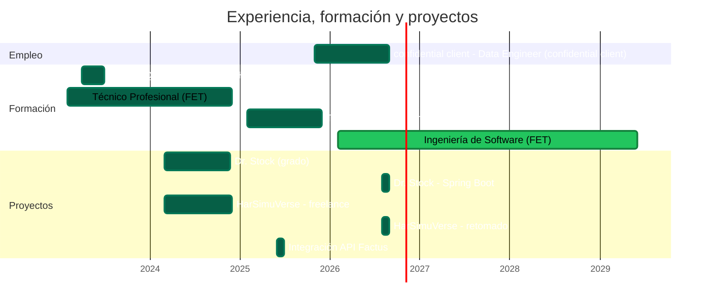
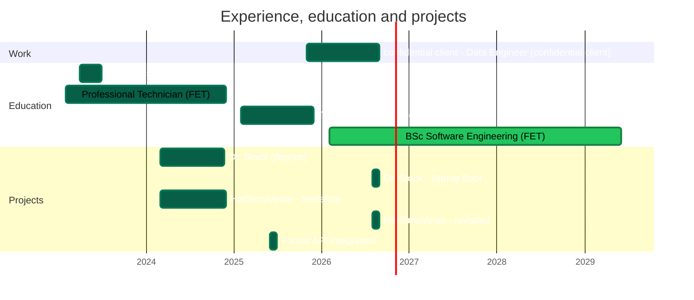

<h3><a href="#es">🇪🇸 Español</a> · <a href="#en">🇬🇧 English</a></h3>

# 🇪🇸 Español

## 👋 Sobre mí

Soy Juan, Data Engineer y desarrollador Fullstack. Me gusta trabajar donde los datos y el código se cruzan: llevar algo desde una idea hasta que corre en producción, y que siga corriendo cuando crece.

Del lado de datos he construido pipelines ETL, automatización y nube; del lado de aplicaciones, sistemas completos de punta a punta: un sistema de inventario y punto de venta, facturación electrónica y una plataforma educativa para niños. Java sigue siendo mi lenguaje preferido; en datos, mi día a día es Python y SQL.

Voy en el **8vo semestre de Ingeniería de Software** en la FET. Fuera del código practico karate desde hace 8 años 🥋: la misma disciplina de repetir hasta que algo funcione bien la aplico al aprender tecnología nueva.

Busco oportunidades **remotas** en ingeniería de datos o backend. Español nativo, inglés conversacional.

## 🧰 Stack tecnológico

| Área | Tecnologías |
|---|---|
| **Lenguajes** |    SQL |
| **Datos** |    Apache Airflow (DAGs, orquestación, reintentos, trazabilidad) · PostGIS · Amazon Athena · DynamoDB · pandas · geopandas · Flyway · ArcGIS · Selenium · docxtpl/Jinja2 · openpyxl |
| **Cloud (AWS)** |    Glue · S3 · Athena · Lambda · ECS · EC2 · DynamoDB · IAM · Secrets Manager · CloudFormation · SAM · AWS CLI |
| **Backend** |    Spring Boot 3.x · Laravel · APIs REST · JWT · arquitectura por capas con DTOs · JUnit |
| **Frontend** |    Angular 17–19 · Ionic · Tailwind · Bootstrap |
| **DevOps & herramientas** |    Docker · GitHub Actions (CI/CD) · Git · GitHub · Bitbucket · Linux · Claude Code |
| **Prácticas** | SOLID · Clean Code · RBAC · pruebas automatizadas con mocking · optimización de rendimiento (consultas SQL, llamadas HTTP/REST, tiempos de compilación y ejecución) · documentación técnica |

## 💼 Experiencia

**Data Engineer — confidential client** · Neiva, híbrido  
*Noviembre 2025 – Agosto 2026*

Diseñé y mantuve un pipeline ETL en Python orquestado con Apache Airflow para el procesamiento de datos geoespaciales, siendo responsable de **más del 80% del código** del proyecto en un equipo de cinco desarrolladores.

El flujo arrancaba con la carga de datos desde **Google Drive hacia S3**, seguía por varias etapas de **ETL** —generando informes en cada paso intermedio— y cerraba con la carga de los resultados a **PostGIS** para el análisis geoespacial. Migré los scripts de **Selenium** que subían esos informes a tareas propias dentro del pipeline. Sobre AWS trabajé de punta a punta: **Glue** para las transformaciones, **Athena** para consultas, **Lambda, ECS y EC2** para cómputo, **IAM y Secrets Manager** para el control de acceso y **CloudFormation** para la infraestructura como código, todo administrado también vía **AWS CLI**.

### ⚡ De 2 horas a 3-4 minutos: optimizando una carga masiva

Heredé un script de Selenium que subía informes en PDF ubicando cada uno por ID mediante **paginación manual y en orden aleatorio**: un registro podía estar en la página 1 o en la 400. Para un lote de apenas 5 archivos, el proceso completo (incluyendo arranque del navegador e inicio de sesión) tardaba cerca de **2 horas**.

Lo rediseñé usando **endpoints REST directos** en lugar de navegar por páginas, y lo integré como un DAG propio dentro de Airflow. El mismo lote pasó a tomar **3-4 minutos** (unas 30 veces más rápido), y la solución escaló a producción con más de **1.000 archivos**.

## 📌 Proyectos destacados

**🤖 [claude-develop-skills — Herramientas para agentes de IA](https://github.com/JuanJo24S/claude-develop-skills)**  
Skills y un hook de seguridad (*git-guard*) para que los agentes de IA trabajen con Pull Requests ordenados: flujo de Git con Conventional Commits, PR con autorrevisión, manejo de secretos y código limpio. El hook bloquea push a `main`, force push, archivos `.env` y secretos antes de que el agente los ejecute.  
`Claude Code` `OpenCode` `Bash` `Git`  
Open source · documentación en español e inglés · 2025 – actualidad

**🗂️ [Dr. Stock — Inventario y Punto de Venta](dr-stock.md)**  
Sistema de inventario y punto de venta para pequeños negocios: control de stock con alertas de reposición, ventas con recibo en PDF y gestión de usuarios por rol.  
`Angular 17` `Tailwind` `Spring Boot 3.3` `Java 17` `PostgreSQL` `Flyway` `JWT` `Docker`  
API REST sin estado, arquitectura en capas con DTOs y 70 pruebas automatizadas.  
🔗 [Demo en vivo](https://dr-stock-gules.vercel.app/auth) · 📄 [Capturas y detalle](dr-stock.md)  
Proyecto de grado, marzo – noviembre 2024 · reescrito en Spring Boot, agosto 2026

**🎮 [HarSimuVerse — Juego Educativo en Angular](harsimuverse.md)**  
Seis minijuegos para que niños de 4 a 12 años aprendan las partes del computador, pensados para tablet: interacción táctil, áreas de toque de 56 px o más y retroalimentación que no depende solo del color. Eliminé el backend original para quitar el costo de hosting y el arranque lento: hoy es una SPA estática.  
`Angular 19` `Tailwind 4` `TypeScript` `Vercel`  
🔗 [Demo en vivo](https://har-simu-verse.vercel.app/home) · 📄 [Capturas y detalle](harsimuverse.md)  
Freelance para docentes universitarios, marzo – noviembre 2024 · refactorizado agosto 2026

**🧾 Integración API Factus**  
Facturación electrónica automatizada dentro de una aplicación Angular.  
`Angular` `API REST`  
🏅 [Certificación de HALLTEC S.A.S](images/factus/certificado-factus.png) — enero 2025

## 📈 Línea de tiempo

## 🎓 Educación

**Ingeniería de Software** — Fundación Escuela Tecnológica de Neiva (FET), Rivera-Huila — *en curso, 8vo semestre*  
Ciclo propedéutico: Tecnología en Desarrollo de Sistemas de Información y Redes (2026) · Técnico Profesional en Soporte de Sistemas Informáticos y Redes (2025)

<a href="#en">🇬🇧 Read in English ↓</a>

---

# 🇬🇧 English

## 👋 About me

I'm Juan, a data engineer and fullstack developer. I like working where data and code meet: taking something from an idea to production, and keeping it running as it grows.

On the data side I've built ETL pipelines, automation and cloud infrastructure; on the application side, complete end-to-end systems: an inventory and point-of-sale system, electronic invoicing and an educational platform for children. Java is still my favourite language; for data work, my day to day is Python and SQL.

I'm in the **8th semester of a BSc in Software Engineering** at FET (Colombia). Outside of code I've practised karate for 8 years 🥋: the same discipline of repeating something until it works well is how I learn new technology.

I'm looking for **remote** roles in data engineering or backend. Native Spanish, conversational English.

## 🧰 Tech stack

| Area | Technologies |
|---|---|
| **Languages** |    SQL |
| **Data** |    Apache Airflow (DAGs, orchestration, retries, traceability) · PostGIS · Amazon Athena · DynamoDB · pandas · geopandas · Flyway · ArcGIS · Selenium · docxtpl/Jinja2 · openpyxl |
| **Cloud (AWS)** |    Glue · S3 · Athena · Lambda · ECS · EC2 · DynamoDB · IAM · Secrets Manager · CloudFormation · SAM · AWS CLI |
| **Backend** |    Spring Boot 3.x · Laravel · REST APIs · JWT · layered architecture with DTOs · JUnit |
| **Frontend** |    Angular 17–19 · Ionic · Tailwind · Bootstrap |
| **DevOps & tools** |    Docker · GitHub Actions (CI/CD) · Git · GitHub · Bitbucket · Linux · Claude Code |
| **Practices** | SOLID · Clean Code · RBAC · automated testing with mocking · performance optimisation (SQL queries, HTTP/REST calls, build and run times) · technical documentation |

## 💼 Experience

**Data Engineer — confidential client** · Neiva, hybrid  
*November 2025 – August 2026*

I designed and maintained a Python ETL pipeline orchestrated with Apache Airflow for geospatial data processing, and was responsible for **more than 80% of the project's codebase** in a five-developer team.

The flow started by loading data from **Google Drive into S3**, went through several **ETL** stages —producing reports at each intermediate step— and ended by loading the results into **PostGIS** for geospatial analysis. I migrated the **Selenium** scripts that uploaded those reports into their own tasks inside the pipeline. On AWS I worked end to end: **Glue** for transformations, **Athena** for queries, **Lambda, ECS and EC2** for compute, **IAM and Secrets Manager** for access control and **CloudFormation** for infrastructure as code, all also managed through the **AWS CLI**.

### ⚡ From 2 hours to 3-4 minutes: optimising a bulk load

I inherited a Selenium script that uploaded PDF reports by locating each one by ID through **manual pagination in random order**: a record could be on page 1 or page 400. For a batch of just 5 files, the whole process (including browser start-up and login) took about **2 hours**.

I redesigned it to use **direct REST endpoints** instead of paging, and turned it into its own DAG inside Airflow. The same batch dropped to **3-4 minutes** (roughly 30 times faster), and the solution scaled to production with more than **1,000 files**.

## 📌 Featured projects

**🤖 [claude-develop-skills — Tooling for AI agents](https://github.com/JuanJo24S/claude-develop-skills)**  
Skills and a safety hook (*git-guard*) so AI agents work with clean Pull Requests: Git flow with Conventional Commits, self-reviewed PRs, secrets handling and clean code. The hook blocks pushes to `main`, force pushes, `.env` files and secrets before the agent runs them.  
`Claude Code` `OpenCode` `Bash` `Git`  
Open source · documented in Spanish and English · 2025 – present

**🗂️ [Dr. Stock — Inventory & Point of Sale](dr-stock.md)**  
Inventory and point-of-sale system for small businesses: stock control with restock alerts, sales with PDF receipts and role-based user management.  
`Angular 17` `Tailwind` `Spring Boot 3.3` `Java 17` `PostgreSQL` `Flyway` `JWT` `Docker`  
Stateless REST API, layered architecture with DTOs and 70 automated tests.  
🔗 [Live demo](https://dr-stock-gules.vercel.app/auth) · 📄 [Screenshots and details (ES)](dr-stock.md)  
Degree project, March – November 2024 · rewritten in Spring Boot, August 2026

**🎮 [HarSimuVerse — Educational game in Angular](harsimuverse.md)**  
Six mini-games that teach children aged 4 to 12 the parts of a computer, built for tablets: touch interaction, tap targets of 56 px or more and feedback that doesn't rely on colour alone. I removed the original backend to cut hosting cost and cold-start latency: it's now a static SPA.  
`Angular 19` `Tailwind 4` `TypeScript` `Vercel`  
🔗 [Live demo](https://har-simu-verse.vercel.app/home) · 📄 [Screenshots and details (ES)](harsimuverse.md)  
Freelance for university lecturers, March – November 2024 · refactored August 2026

**🧾 Factus API integration**  
Automated electronic invoicing inside an Angular application.  
`Angular` `REST API`  
🏅 [HALLTEC S.A.S certificate](images/factus/certificado-factus.png) — January 2025

## 📈 Timeline

## 🎓 Education

**BSc Software Engineering** — Fundación Escuela Tecnológica de Neiva (FET), Rivera-Huila, Colombia — *in progress, 8th semester*  
Built on a Colombian *ciclo propedéutico*, where each stage is a separately awarded qualification: Technologist Degree in Information Systems & Networks Development (2026) · Professional Technician in IT Systems & Network Support (2025)

<a href="#es">🇪🇸 Leer en español ↑</a>

---

📫 **¿Hablamos? · Let's talk!** [LinkedIn](https://www.linkedin.com/in/juan-jose-valbuena-camacho-848549278) · [juanjosecodes24@gmail.com](mailto:juanjosecodes24@gmail.com)

