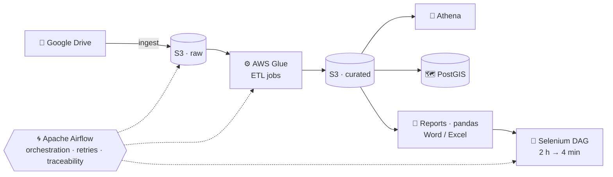
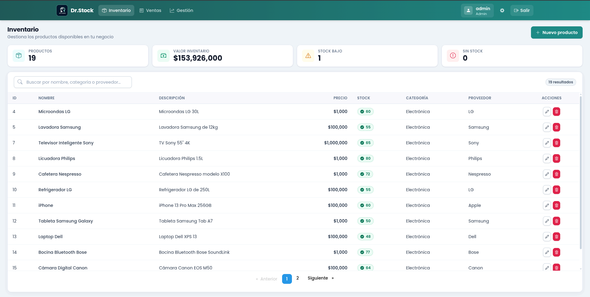
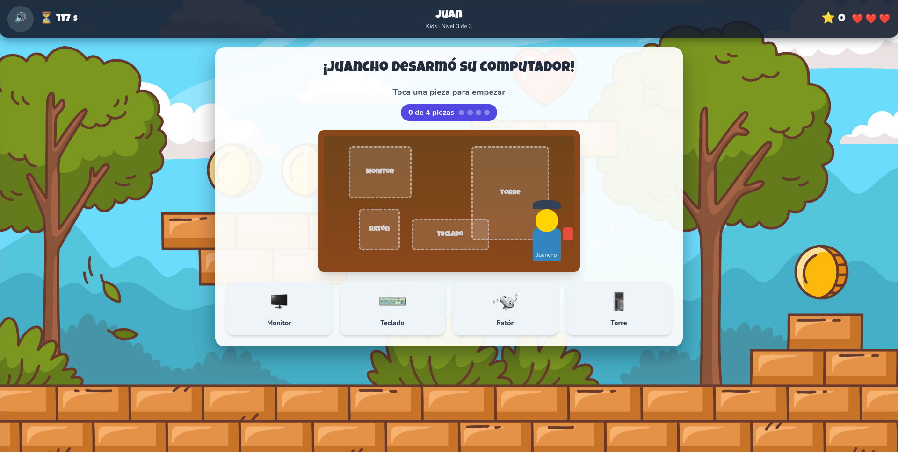
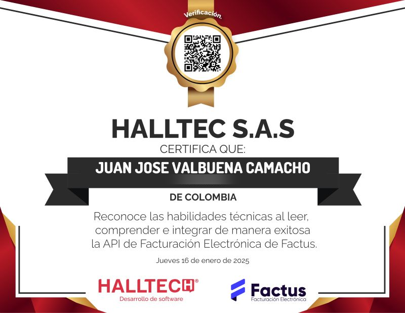
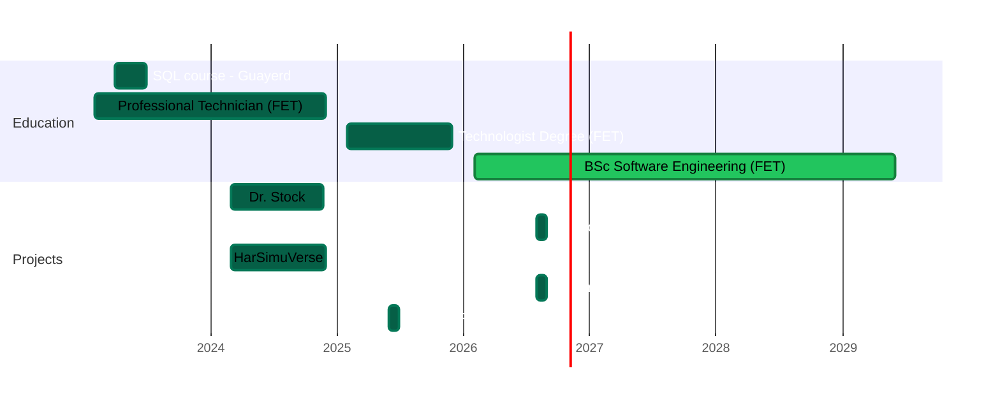

**Data engineer from Colombia who turns slow, fragile data processes into fast, traceable pipelines in production.** 
<i>Data Engineer en Colombia: convierto procesos de datos lentos y frágiles en pipelines rápidos y trazables en producción.</i>

## ⚡ Impact · Impacto

<table>
<tr>
<td align="center" width="25%"><h1>30×</h1><b>faster ingestion</b> 2 h → 3–4 min per batch <i>carga 30 veces más rápida</i></td>
<td align="center" width="25%"><h1>1,000+</h1><b>files per run</b> in production on AWS <i>archivos por corrida en producción</i></td>
<td align="center" width="25%"><h1>80%+</h1><b>of the codebase</b> principal contributor, 5-dev team <i>del código, equipo de 5</i></td>
<td align="center" width="25%"><h1>1,400+</h1><b>lines of AWS Glue</b> production ETL jobs <i>líneas de jobs ETL en producción</i></td>
</tr>
</table>

## 🛰️ A production data pipeline I built · Un pipeline en producción que construí

**Data Engineer** · geospatial data platform for a client · plataforma de datos geoespaciales para un cliente

Also: Lambda · ECS · EC2 · IAM · Secrets Manager · CloudFormation/SAM · pandas · geopandas · automated tests with mocking · schema and geometry validation

## 📌 Featured projects · Proyectos destacados

<table>
<tr>
<td width="50%" valign="top">

<h3>🤖 claude-develop-skills</h3>
Skills and a <b>git-guard</b> hook so AI agents ship clean Pull Requests: it blocks pushes to <code>main</code>, force pushes, <code>.env</code> files and secrets before the agent runs them. 
<i>Skills y un hook para que los agentes de IA trabajen con PR ordenados y seguros.</i>  
<code>Claude Code</code> <code>OpenCode</code> <code>Bash</code> <code>Git</code> 
<a href="https://github.com/JuanJo24S/claude-develop-skills">Repo →</a>
</td>
<td width="50%" valign="top">

<h3>🗂️ Dr. Stock</h3>
Inventory and point-of-sale system: stock alerts, PDF receipts and role-based users. Stateless REST API, layered architecture, <b>70 automated tests</b>. 
<i>Inventario y punto de venta · proyecto de grado, reescrito en Spring Boot.</i>  
<code>Spring Boot 3.3</code> <code>Java 17</code> <code>Angular 17</code> <code>PostgreSQL</code> <code>Flyway</code> <code>JWT</code> <code>Docker</code> 
<a href="https://dr-stock-gules.vercel.app/auth">Live demo →</a> · <a href="dr-stock.md">Details (ES) →</a>
</td>
</tr>
<tr>
<td width="50%" valign="top">

<h3>🎮 HarSimuVerse</h3>
Six Angular mini-games that teach kids aged 4–12 the parts of a computer, built for tablets. Removed the backend to cut hosting cost: now a static SPA. 
<i>Juego educativo · freelance para docentes universitarios.</i>  
<code>Angular 19</code> <code>Tailwind 4</code> <code>TypeScript</code> <code>Vercel</code> 
<a href="https://har-simu-verse.vercel.app/home">Play →</a> · <a href="harsimuverse.md">Details (ES) →</a>
</td>
<td width="50%" valign="top">

<h3>🧾 Factus API integration</h3>
Automated electronic invoicing inside an Angular application, certified by <b>HALLTEC S.A.S</b> (January 2025). 
<i>Facturación electrónica automatizada con la API de Factus.</i>  
<code>Angular</code> <code>REST API</code> 
<a href="images/factus/certificado-factus.png">Certificate →</a>
</td>
</tr>
</table>

## 🧰 Tech stack

<b>Full stack · Stack completo</b>

 

| Area · Área | Technologies · Tecnologías |
|---|---|
| **Languages** | Java · Python · SQL · TypeScript · JavaScript · C · C++ · C# · PHP · Bash · HTML · CSS |
| **Data** | Apache Airflow (DAGs, orchestration, retries, traceability) · PostgreSQL · PostGIS · MySQL · Amazon Athena · DynamoDB · pandas · geopandas · Flyway · ArcGIS · Selenium · docxtpl/Jinja2 · openpyxl |
| **Cloud (AWS)** | Glue · S3 · Athena · Lambda · ECS · EC2 · DynamoDB · IAM · Secrets Manager · CloudFormation · SAM · AWS CLI |
| **Backend** | Spring Boot 3.x · Laravel · REST APIs · JWT · layered architecture with DTOs · JUnit |
| **Frontend** | Angular 17–19 · Ionic · Tailwind · Bootstrap |
| **DevOps & tools** | Docker · GitHub Actions (CI/CD) · Git · GitHub · Bitbucket · Linux · Claude Code |
| **Practices** | SOLID · Clean Code · RBAC · automated testing with mocking · performance optimisation (SQL, HTTP/REST, build and run times) · technical documentation |

## 👋 About me · Sobre mí

<b>🇬🇧 Read in English</b>

 

I'm Juan, a data engineer and fullstack developer. I like working where data and code meet: taking something from an idea to production, and keeping it running as it grows.

In my last role I designed and maintained a Python ETL pipeline orchestrated with Apache Airflow for geospatial data, and wrote more than 80% of the project's code in a five-developer team. My best-known fix: a Selenium script located each PDF report by walking **randomly ordered pages** (a record could be on page 1 or page 400), so 5 files took about **2 hours**. I rewrote it against **direct REST endpoints** as its own Airflow DAG: the same batch took **3–4 minutes**, and it scaled to **1,000+ files** in production.

Before that I built complete applications end to end: an inventory and point-of-sale system, electronic invoicing and an educational platform for children. Java is still my favourite language; for data work, my day to day is Python and SQL.

I'm in the **8th semester of a BSc in Software Engineering** at FET (Colombia), with Professional Technician and Technologist degrees already awarded. Outside of code I've practised karate for 8 years 🥋: the same discipline of repeating something until it works well is how I learn new technology.

**Looking for:** remote roles in data engineering or backend. Native Spanish, conversational English.

<b>🇪🇸 Leer en español</b>

 

Soy Juan, Data Engineer y desarrollador Fullstack. Me gusta trabajar donde los datos y el código se cruzan: llevar algo desde una idea hasta que corre en producción, y que siga corriendo cuando crece.

En mi último rol diseñé y mantuve un pipeline ETL en Python orquestado con Apache Airflow para datos geoespaciales, y escribí más del 80% del código del proyecto en un equipo de cinco desarrolladores. Mi arreglo más conocido: un script de Selenium ubicaba cada informe PDF recorriendo **páginas en orden aleatorio** (un registro podía estar en la página 1 o en la 400), así que 5 archivos tardaban cerca de **2 horas**. Lo reescribí con **endpoints REST directos** como un DAG propio en Airflow: el mismo lote pasó a **3–4 minutos** y escaló a **más de 1.000 archivos** en producción.

Antes construí aplicaciones completas de punta a punta: un sistema de inventario y punto de venta, facturación electrónica y una plataforma educativa para niños. Java sigue siendo mi lenguaje preferido; en datos, mi día a día es Python y SQL.

Voy en el **8vo semestre de Ingeniería de Software** en la FET, con los títulos de Técnico Profesional y Tecnólogo ya obtenidos. Fuera del código practico karate desde hace 8 años 🥋: la misma disciplina de repetir hasta que algo funcione bien la aplico al aprender tecnología nueva.

**Busco:** oportunidades remotas en ingeniería de datos o backend. Español nativo, inglés conversacional.

## 📈 Timeline · Línea de tiempo

## 🎓 Education · Educación

**BSc Software Engineering · Ingeniería de Software** — Fundación Escuela Tecnológica de Neiva (FET), Colombia — *8th semester · 8vo semestre*  
Technologist Degree in Information Systems & Networks Development (2026) · Professional Technician in IT Systems & Network Support (2025)

 

**Let's talk · ¿Hablamos?** → [LinkedIn](https://www.linkedin.com/in/juan-jose-valbuena-camacho-848549278) · [juanjosecodes24@gmail.com](mailto:juanjosecodes24@gmail.com)

